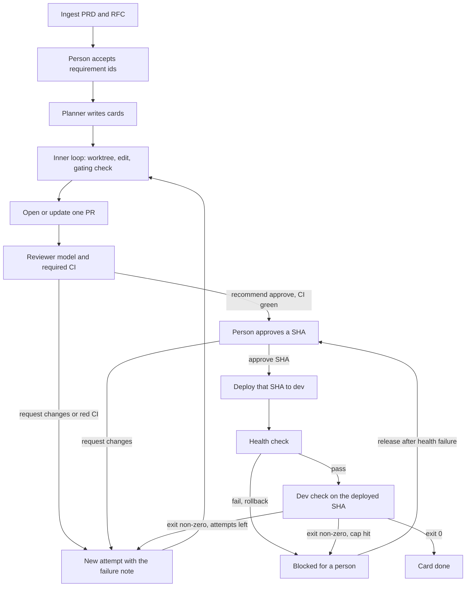

# AI Coding Orchestrator: overview

Status: Overview. Date: 2026-10-10. Revised after review.

This page is the short version. It is a summary, so when it disagrees with another document, the other document wins. [README.md](README.md) lists every document and the order of precedence. The requirements are in [prd/coding-orchestrator.md](prd/coding-orchestrator.md), the decisions in `rfc/`, and the implementation guides in `tech/`.

## The key point

The harness is a state machine over kanban cards. Models propose edits and review comments. A command exit code, a health check, and a person's approval decide whether a card moves. Dev deploy runs only for the commit a person approved. If the test against that deploy fails, the card comes back as a new attempt and the loop repeats.

A model call is a step inside a state. It is not the workflow.

## Original brief

This is the refined prompt the design started from. It is kept as history. The PRD replaced it as the requirements source, and later decisions added the following:

- A local SvelteKit web UI beside the CLI, with settings pages for GitHub, model APIs, the router, and deploy (RFC-035).
- A data directory outside the target repo (RFC-036).
- Checks that run on exported copies, with network only for dev checks (RFC-037).
- Deploy scripts that live outside the repo (RFC-038).
- Probes that can reach private dev hosts but not link-local or loopback addresses (RFC-039).
- Compare-and-swap transitions (RFC-040), an explicit release policy (RFC-041), an attempt cap that counts implementer attempts only (RFC-042), and one worker process (RFC-043).

```text
Build a coding orchestrator that turns a PRD and its RFCs into reviewed, tested changes on a dev server.

The orchestrator is a harness. The kanban board is its source of truth. Language models are workers the harness calls and routes. The harness stores status, locks, credentials, and gates. A model cannot advance a card, open a second pull request for the same card, or deploy.

Required behavior:

1. Ingest a PRD and the RFCs that constrain it. Produce requirement ids, decisions, acceptance checks, and explicit non-goals. A person accepts that extract before any card is implemented.
2. Decompose accepted requirements into kanban cards with dependencies, a risk level, linked requirement ids, and a test command. Leave the test command empty only when the check is inherently manual. Do not start a card until every card it depends on is done.
3. Route each task to a model by task class (plan, implement, review, failure triage), risk, context size, failure count, and remaining budget. Persist the model id, fallback model id, and prompt hash on the attempt.
4. Run the implementer in a fresh git worktree, one writer per card. The implementer may read, edit, run the card's local checks, and commit. It has no merge right, no deploy credentials, and no production credentials.
5. Inner loop, on the worktree only: edit, run local checks, read the failure, try again. Cap attempts, tokens, and wall time. This loop never deploys. A check passes only when the command exits 0.
6. When local checks pass, open one pull request for the card. If a PR already exists, push to the same branch and update that PR. The idempotency key is the card id.
7. Run a reviewer model on the PR. Prefer a different provider family from the author. Give the reviewer the linked requirements, the diff, and the check output. Omit the author's transcript and tool trace.
8. A person reviews the same PR. The reviewer model may request changes or recommend approval. Only a person on the approver list can approve, and the approval is bound to the PR head SHA. A new commit invalidates it.
9. When the head SHA is approved and required checks are green, deploy that SHA to the dev server. Deploy the approved SHA, not whatever the default branch points at later. Take one deploy lock for v1 so two cards cannot deploy over each other. If the health check fails, roll back, record the failure, and block the card. Do not start tests against an unhealthy deploy.
10. The harness runs the card's dev tests against that deployment. Pass and fail come from the command exit code. On pass, mark the card done. On fail, store the log, write a triage note with a model if you need one, and move the card to changes requested. Start a new attempt. After the attempt cap, block the card for a person.
11. Repeat from the next ready card. A failed verify starts a new attempt from the card, the diff, and the failure log. It does not continue the old model conversation.

Harness invariants, required in v1:

- Card transitions are a pure function of the current status plus evidence. Illegal transitions are rejected and logged.
- Side effects are idempotent. PR create, PR comment, and deploy use a stable key.
- A crashed process resumes from the last recorded gate.
- Planner, implementer, reviewer, and triage each get a fixed context pack. Deploy has no model.
- Tool allowlists and credentials differ by role.
- Every model call, tool call, gate result, and route decision is appended to an event log with model id, prompt hash, and token use.
- Attempt, token, and time budgets end in Blocked, waiting for a person.

v1 ends at the dev server. Out of scope: production deploy, auto-merge, more than one writer on a card, and any path where a model sets card status directly.

Deliver the state machine, the router policy, the context packs, the gate predicates, the data records, and the implementation order. Implement the state machine and a fake worktree before calling a live model.
```

## Two loops

Keep these apart in code. One function should not do both.

| Loop | Where it runs | Allowed to deploy | Success signal | On failure |
| --- | --- | --- | --- | --- |
| Inner | Card worktree, checks on an exported copy | No | The gating local check on the committed SHA exits 0 | New attempt until the cap, then blocked |
| Outer | Pull request, review, dev server | Yes, after human approval of that SHA | The dev check exits 0 on the deployed SHA after a healthy deploy | New attempt, or blocked at the cap |



## Harness key points

1. **The board is the memory.** Status, SHA, PR URL, and attempt count live on the card. The next model call is built from the card and the context pack. The previous conversation is disposable.
2. **Two loops.** The inner loop ends at a green gating check and a PR. The outer loop starts at review. Deploy exists only on the outer loop, and only after approval.
3. **Gates are predicates.** `Transition` checks evidence in code. A sentence in a model reply cannot satisfy `local_checks`, `human_approval`, `dev_health`, or `dev_tests`.
4. **Exit codes and health are the oracles.** A check passes when the process exits 0. Health passes when the configured probe returns 200. Triage may explain a failure. It does not grade it.
5. **One card, one worktree, one writer.** A card lock with a holder id stops a second job from editing the same branch.
6. **One PR per card.** Retries push to `orch/<card-id>`. Create and update are idempotent on the card id.
7. **Approval is a SHA, plus a person.** The approver is on an allowlist. The bot's review is a recommendation. A push after approval clears `approvedSha`.
8. **Cold review.** The reviewer pack has the diff, the requirements, and the check output. It does not have the author's transcript.
9. **Different family on review when you have one.** The attempt stores whether the reviewer family differed.
10. **Pin the deploy.** The deployer ships the approved SHA, and the dev check runs on an export of that SHA.
11. **Health before tests.** A failed health check rolls back and blocks. Release sends the card back to human review, not to the implementer.
12. **One deploy at a time in v1.** The deploy lock serializes the shared dev server. Implementers keep working on other cards.
13. **Resume at the last gate.** Startup reconciles an in-flight deploy first, then continues from the stored status.
14. **Role-scoped tools and credentials.** The implementer cannot deploy. The reviewer cannot edit. The deployer has no model. Repo content is untrusted input.
15. **Budgets stop the loop.** The attempt, token, turn, and wall-clock caps all end in `blocked` with the reason stored. A person releases the card. The loop does not raise its own cap.
16. **Routes are versioned.** Model id, fallback id, prompt hash, and system hash are on the attempt. A settings change applies to the next job, not to one in flight.
17. **Requirement ids thread end to end.** They start at intake, sit on the card, appear in the PR body, and are the reviewer's checklist.
18. **The scheduler respects dependencies.** A card becomes `ready` only when every card it depends on is `done`. The planner proposes the edges. The harness enforces them.
19. **Transitions are compare-and-swap.** Two clients acting at once cannot both win.
20. **State lives outside the repo.** Settings, tokens, and the board sit in the data directory, where no pull request can reach them.
21. **Checks never touch the worktree.** They run on an exported copy, so a test cannot rewrite git metadata the host will trust.
22. **What deploy runs is operator-owned.** Deploy and rollback scripts are absolute paths outside the repo.
23. **The UI renders what the server allows.** Buttons come from the `actions` list. The client never computes legality.

## Where the details live

| Topic | Document |
| --- | --- |
| Requirements and acceptance checks | [prd/coding-orchestrator.md](prd/coding-orchestrator.md) |
| State edges | PRD REQ-006 |
| Architecture decisions | [rfc/0001-v1-architecture.md](rfc/0001-v1-architecture.md) |
| Hardening decisions | [rfc/0002-hardening.md](rfc/0002-hardening.md) |
| Corrections from review | [rfc/0003-review-corrections.md](rfc/0003-review-corrections.md) |
| Stack and tools | [tech/0001-implementation.md](tech/0001-implementation.md) |
| Schema, API, settings shape | [tech/0002-data-and-api.md](tech/0002-data-and-api.md) |
| Worker, jobs, router, git | [tech/0003-backend.md](tech/0003-backend.md) |
| SvelteKit client | [tech/0004-frontend.md](tech/0004-frontend.md) |
| Tests and release order | [tech/0005-verification.md](tech/0005-verification.md) |
| Security controls | [tech/0006-security-and-harness.md](tech/0006-security-and-harness.md) |
