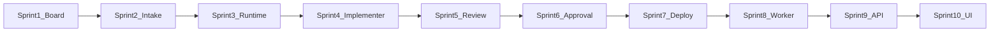

# Sprint plan

Status: Accepted for implementation. Date: 2026-10-10.

This is the build schedule. It follows the order in [../tech/0003-backend.md](../tech/0003-backend.md) (steps 1 to 12, then the frontend). Tests are the ones named in [../tech/0005-verification.md](../tech/0005-verification.md) and [../tech/0006-security-and-harness.md](../tech/0006-security-and-harness.md). Contract fields come from [../tech/0002-data-and-api.md](../tech/0002-data-and-api.md). The UI comes from [../tech/0004-frontend.md](../tech/0004-frontend.md).

If this file disagrees with a PRD acceptance check, an RFC statement, or a tech guide, the other document wins. See [../README.md](../README.md).

A sprint is done when its tests pass. The next sprint does not start on a failing suite. Live Anthropic or OpenAI keys are not required. The fake provider and the health stub cover the release bar.

Progress is tracked in [checklist.md](checklist.md).

## Sprint 1: The board cannot skip a gate

Goal: Card status changes only through compare-and-swap, the event log is insert-only, and the data directory cannot sit inside the target repo.

Backend step 1. Packages: `internal/machine`, `internal/trace`, `internal/board`, `cmd/orchestrator` startup.

- Create `backend/` as module `orchestrator/backend` on Go 1.26, with goose migration `00001_init.sql` (postgres dialect) from the schema in the data contract. The board is PostgreSQL 16 or newer through pgx. There is no SQLite file.
- `go test` needs `ORCHESTRATOR_TEST_DATABASE_URL`. A missing variable fails the test with that name before any card is written. Tests do not use testcontainers. Each test migrates that database and isolates its rows.
- Implement `Transition`: the REQ-006 edge map, evidence checks, and compare-and-swap (RFC-040). `done` has no outbound edge.
- Append events with redaction. Triggers reject `UPDATE` and `DELETE` on `events` (RFC-031).
- Startup refuses `--data` inside the repo or the worktree (RFC-036) and refuses a non-loopback `--addr` (RFC-032).

Done when: `TestEdgesMatchPRD`, `TestIllegalDeploySkip`, `TestEvidenceRequired`, `TestTransitionCAS`, `TestRedact`, `TestEventsImmutable`, `TestDataDirInsideRepo`, `TestLoopbackOnly`.

## Sprint 2: Nothing starts until a person accepts the ids

Goal: A PRD and its RFCs become requirement and decision records, and `run-next` creates no worktree before acceptance.

Backend step 2. Package: `internal/intake`, accept in `internal/app`.

- Parse markdown with goldmark. Keep existing `REQ-` and `RFC-` ids. A file with no ids sets `draftPending` and stores drafted rows as unaccepted.
- Record operator acceptance. Re-parse clears acceptance only for changed ids (RFC-019).
- CLI: `ingest`, `accept`, and `status` on an empty board (the empty-board and missing-`--sha` CLI checks).

Done when: `TestDraftIds`, and `status` on an empty data dir prints `board is empty` and `orchestrator ingest`. No worktree package exists yet.

## Sprint 3: Checks cannot rewrite the worktree

Goal: Git can open one worktree per card, and a check runs on an exported copy with a scrubbed argv. No model is called.

Backend step 3. Packages: `internal/execx`, `internal/sandbox`, `internal/runtime`. Fixture repo under `backend/testdata/fixture-repo`.

- `execChild`: argv only, built env, timeout, output cap. Refuse `sh` and `bash` (RFC-027).
- Sandbox argv: `--network=none` for local checks, digest pin, export mount, no Docker socket, no worktree path (RFC-028, RFC-037). Dev-check argv is specified here but executed in Sprint 7.
- Worktree and commit identity without a model. Git runs with hooks off, `core.fsmonitor` off, and a private `GIT_CONFIG_GLOBAL` (RFC-033).
- Path rule: reject `../`, absolute paths, `.git/config`, and symlinks that leave the worktree.

Done when: `TestWorktreeOnce`, `TestCheckExit`, `TestCommandAllowlist`, `TestEnvScrub`, `TestCheckOnExport`, `TestPathEscape`, `TestSandboxFlags`, `TestNoShell`, `TestHookNotRun`, `TestFsmonitorOff`, `TestTarEscape`, `TestCheckParse`.

## Sprint 4: A scripted implementer can commit

Goal: One fake model edits the fixture repo and commits. Exit code 0 is the only way a check passes. The implementer has no deploy tool.

Backend step 4. Packages: `internal/providers/fake`, `internal/contextpack` implementer pack, tool loop.

- Fake provider replays scripts by task class and attempt. It records the system and user strings.
- Tool loop stops at `maxTurns`. Unknown tools and a scripted `deploy` call are rejected and do not exec.
- `create_card` cannot set the check command. Checks come from settings.
- No commit counts as an implementer attempt and writes a `no_commit` note. `run_local_check` inside the attempt does not move status.
- Prompt packs wrap untrusted text in the markers from the security guide. Commit trailers are `Orchestrator-Card`, `Orchestrator-Attempt`, and `Model`.

Done when: `TestImplementerTools`, `TestToolNotInProfile`, `TestNoCommitAttempt`, `TestToolCheckDoesNotMove`, `TestCommitIdentity`, `TestPromptMarkers`, `TestCreateCardIgnoresCommand`.

## Sprint 5: One pull request, then a cold review

Goal: A card has one pull request on `orch/<card-id>`. The reviewer is a different provider family when two are configured, and its prompt has the diff and not the author transcript.

Backend steps 5 and 6. Packages: `internal/vcs`, reviewer pack, router family choice.

- Ensure-PR is idempotent on card id. Metadata block is rewritten on each push. The summary block stays. Push uses the settings URL and the card refspec only, with the token in askpass, not in argv (RFC-034).
- Reviewer verdicts: `request_changes` to `changes_requested`, `recommend_approve` plus green required CI to `human_review`. Pending CI stays in `agent_review`. Red CI goes to `changes_requested` with a `ci` note.
- Review and triage do not increment `attempts_used` (RFC-042). `review_independent` is stored and is false when only one family is configured (RFC-008).

Done when: `TestPROnce`, `TestMetadataRewrite`, `TestPushURL`, `TestAskpass`, `TestReviewerPack`, `TestReviewNotCounted`, `TestCIPending`, `TestCIRed`, `TestRouteClass`, `TestNoDeployClass`.

## Sprint 6: Approval is a person and a SHA

Goal: Only an allowlisted login can approve the current head. A later commit, a request for changes, or a reject clears that approval and does not deploy.

Backend step 7. Human gates in `internal/app` and the CLI.

- `approve --sha`, `request-changes`, `reject`, `unblock`. Missing or wrong SHA exits 1 and writes no approval row.
- Same SHA twice inserts one approval. Bot login cannot be an approver.
- Unblock destinations follow RFC-041: budget and reject go to `ready`; `health`, `deploy_failed`, and `deploy_config` go to `human_review`. `source_changed` stays blocked while a linked id is unaccepted. Default release at the cap raises `max_attempts` by one. `--reset-attempts` zeros `attempts_used`.

Done when: `TestApprovedHeadMoved`, `TestRequestChangesFromApproved`, `TestRejectFromApproved`, `TestApproveSha`, `TestApproveIdempotent`, `TestStaleSHA`, `TestUnblockDestinations`, `TestUnblockAtCap`, `TestUnblockReset`, `TestUnblockSourceChanged`, `TestCapFromChangesRequested`, plus the CLI approve and unblock checks.

## Sprint 7: Deploy the approved SHA, then test it

Goal: Deploy and health run only for the approved SHA. A failed probe rolls back and blocks. Dev tests run after health, on an export of that SHA. A crash mid-deploy reconciles before a second deploy.

Backend step 8. Packages: `internal/deploy`, `internal/verify`. Stub health server and `testdata/bin/deploy-stub`.

- Deploy and rollback commands are absolute paths outside the repo and the data directory, mode `0700` or `0500` (RFC-038). The SHA argument is 40 or 64 hex only.
- Probe allows a listed dev host, refuses link-local, loopback outside fixture mode, and unlisted hosts. A redirect is a failure (RFC-039).
- Empty `dev_check` plus a healthy probe is `health_only` and `done`. A failing dev check returns to `changes_requested` on the same PR and stores the triage note.
- Reconcile: deploy event without health probes or rolls back before another deploy exec. Commit without a gating check reruns the check and does not call the model.

Done when: `TestDeployFailed`, `TestHealthFail`, `TestHealthOnly`, `TestDevFailThenPass`, `TestVerifyAtDeployedSHA`, `TestDeployCommandPath`, `TestSHAArg`, `TestHealthLinkLocal`, `TestHealthLoopback`, `TestHealthPrivateListed`, `TestHealthUnlisted`, `TestHealthRedirect`, `TestReconcileDeploy`, `TestReconcileCommit`, `TestDevCheckNetwork`.

## Sprint 8: One worker runs the board

Goal: Settings and secrets live in the data directory, route changes apply to the next job only, and a single worker advances ready cards without two deploys at once.

Backend steps 9 and 10. Packages: `internal/settings`, `internal/router`, `internal/worker`.

- `config.yaml` and mode `0600` `secrets.json`. GET never returns a token. PUT without a secret field keeps the stored bytes. Short secrets and unknown model ids are `422`. A config change event names fields, not values (RFC-030).
- Router: retry primary once, then one fallback, then `blocked` with `provider_error`. Empty route blocks with `router_config`. A save during a running attempt does not change that attempt's model.
- Worker lock file. A second `serve` exits. Plan job creates cards only for accepted ids and refuses a dependency cycle. Implementation cap and the global deploy lock are enforced. A moved base ref blocks with `base_moved`.

Done when: `TestSecretOmitted`, `TestSecretKeep`, `TestShortSecret`, `TestUnknownModel`, `TestModelIdUnique`, `TestBotApprover`, `TestConfigEvent`, `TestSnapshot`, `TestRouterConfig`, `TestFallbackOnce`, `TestPlanCards`, `TestWorkerLock`, `TestDependency`, `TestDeployLock`, `TestCap`, `TestBaseRefUnchanged`, `TestLockHolder`.

## Sprint 9: The fixture script and the JSON API

Goal: `go run ./cmd/fixture` exits 0 on the nine REQ-043 steps, and every route in the data contract uses the same service functions as the CLI.

Backend steps 11 and 12. `cmd/fixture`, `internal/httpapi`.

- Fixture runner uses a temp data directory, copies the deploy stub outside the repo, replays the fake provider for two families, and requires a clean `git status` in the fixture repo (REQ-045).
- HTTP: bearer session, loopback `Host` check, CORS only for `http://127.0.0.1:4173`, 1 MiB body cap, the error shape from the contract. Card JSON includes server-computed `group`, `actions`, and `unblockTo`.
- Session lockout after 5 failures. Wrong `Origin` and evil `Host` are `403`.

Done when: `go run ./cmd/fixture` exits 0, and `TestActionsEmpty`, `TestActionsApproved`, `TestCORS`, `TestHostHeader`, `TestSessionLockout`, `TestRedactPack`, `TestSandboxOffRejected`, `TestAskpass` still pass inside `go test ./...`.

## Sprint 10: The operator UI and the release pass

Goal: A local SvelteKit app can log in, run the board, accept requirements, approve a SHA, and save GitHub, model, router, and deploy settings. Buttons come only from `actions`. The release checklist in the verification guide passes.

Frontend from [../tech/0004-frontend.md](../tech/0004-frontend.md), after Sprint 9. Node is the Vite toolchain only. No `+server.ts` and no React.

- App shell: client-only SvelteKit, `adapter-static`, CSP meta, session bearer in `sessionStorage`, `src/lib/api.ts` covering every route.
- Work pages: `/login`, `/` (six groups, Run, 3s poll), `/intake`, `/cards/[id]`, `/cards/[id]/trace`. `CardActions` renders only names in `actions`.
- Settings pages: GitHub, LLM APIs, router, deploy. `SecretField` omits an empty secret and never prints a token.
- Styles: system font, one `.primary` button, `.danger` only for blocked, 44px controls, visible focus, one column under 720px.

Done when, in order:

- `npm run check`, `npm run test`, `npm run build`, and `npm audit --omit=dev` from `frontend/`.
- Vitest: `CardActions` empty, approved, and `unblockTo: null`; `SecretField` omits the secret; `api` clears the bearer on 401; built `index.html` has the CSP meta and no `unsafe-inline`.
- Manual browser pass on fixture cards, from the table in the verification guide.
- Optional, after that pass: one real dev host using the same deploy code, with secrets only in `secrets.json`. That run is recorded by hand and is not part of `go test`.
